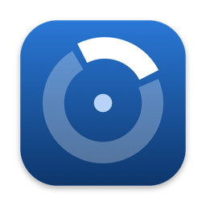
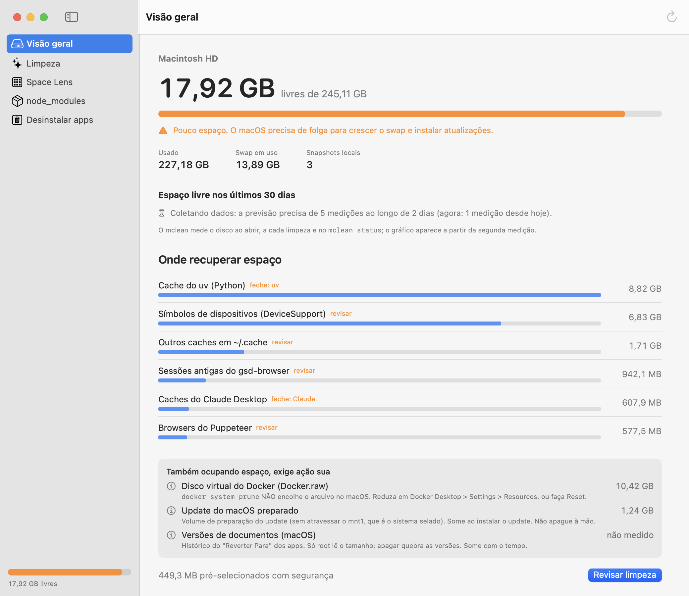
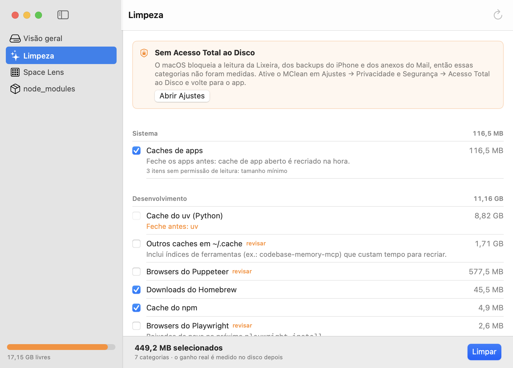
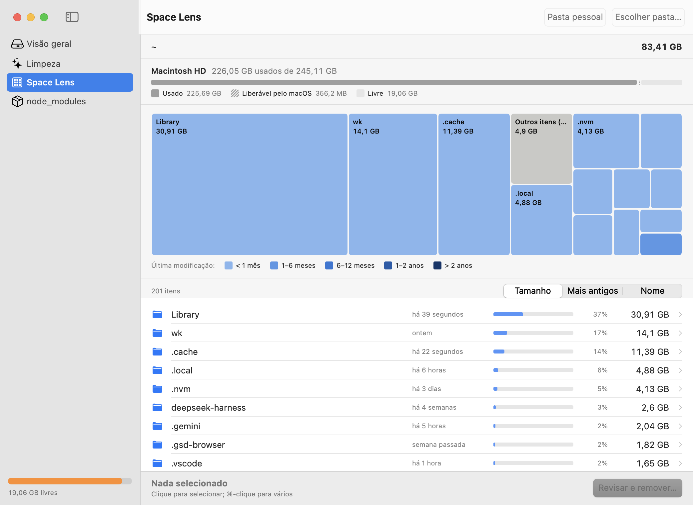
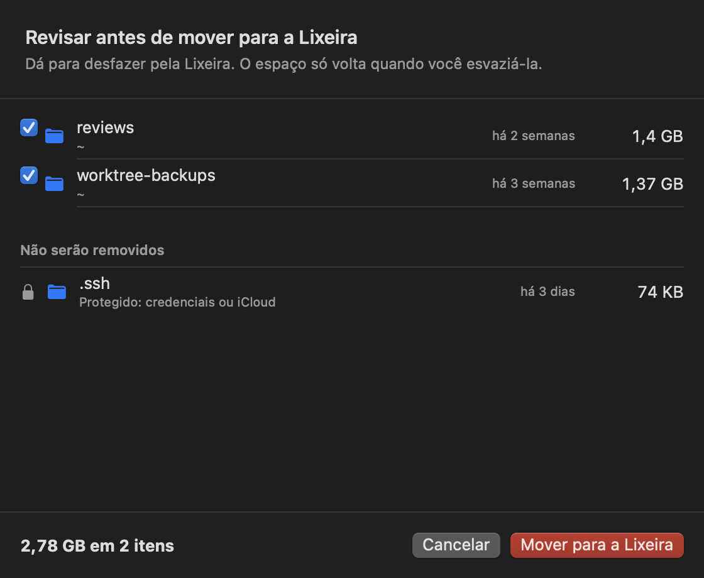
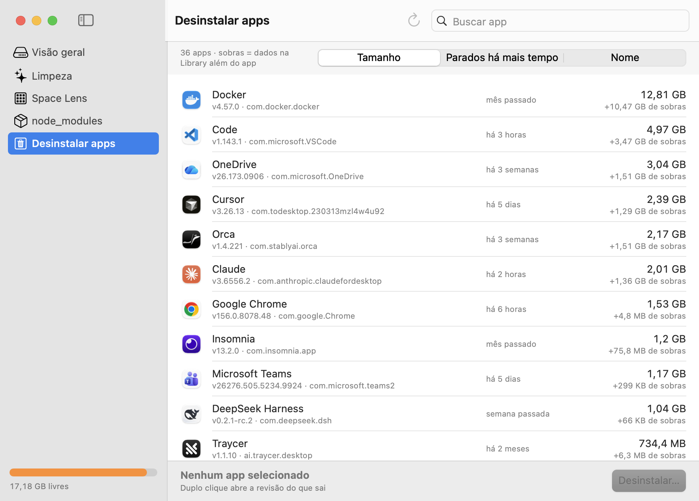
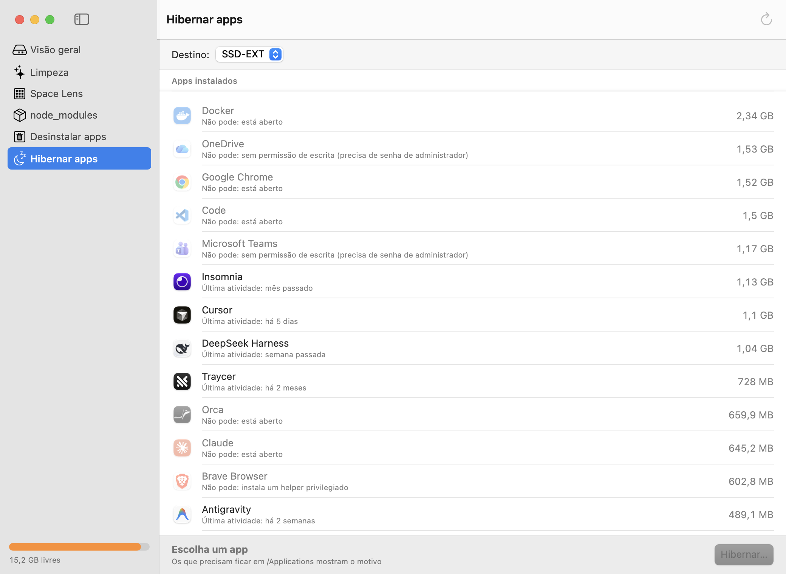
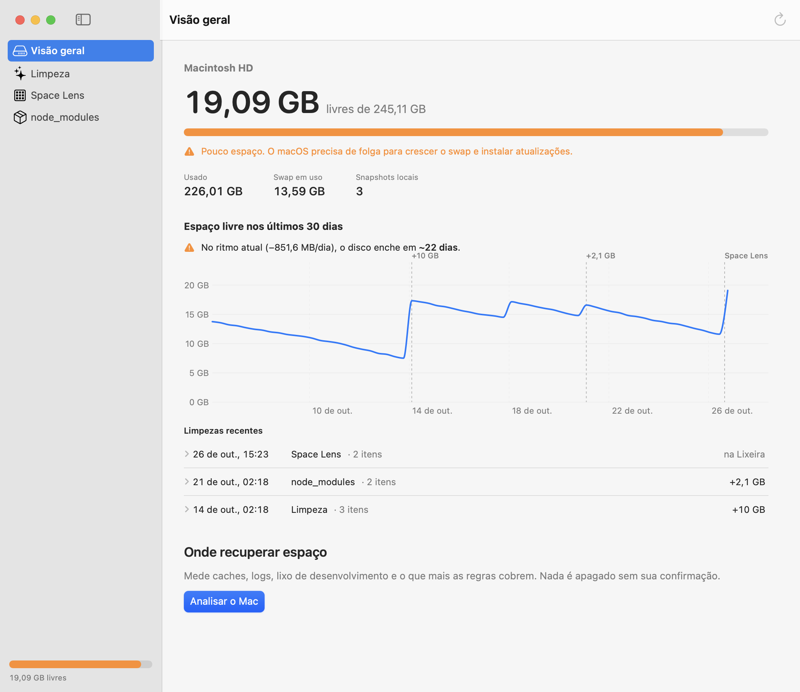

<p align="center"></p>

<h1 align="center">MClean</h1>

<p align="center">Limpeza de disco para Mac com pouco espaço: mede o que ocupa, mostra o que é seguro apagar
e nunca apaga sem você ver antes. App SwiftUI + CLI sobre o mesmo motor.</p>

Nasceu num MacBook Air de 256 GB que vivia sem espaço. Na primeira limpeza real liberou **10 GB medidos no
disco**, e o espaço livre foi de 5,5 GB para 19 GB no mesmo dia.

## O que faz

### Visão geral

Espaço livre, swap e snapshots, onde recuperar espaço, e o que ocupa disco mas exige ação sua (ex.: `Docker.raw`, que o `docker system prune` não encolhe).



### Limpeza

Regras explícitas: caches, logs, lixo de desenvolvimento e de ferramentas de IA. As seguras vêm marcadas, as que pedem revisão não, e regra de app aberto fica bloqueada. O ganho é **medido no disco**, não estimado.



### Space Lens

Mapa (treemap) de cada pasta: área = tamanho, cor = há quanto tempo nada muda ali. Barra do disco com o que o próprio macOS libera sozinho. Lista por tamanho, data ou nome, com Quick Look.



### Revisar antes de remover

Tudo vai para a Lixeira (reversível). Itens protegidos (credenciais, iCloud, pastas do sistema) aparecem com o motivo, em vez de sumir.



### Desinstalar apps

App + sobras na Library (por bundle id, LaunchAgents e, desmarcadas, por nome) e a última atividade de cada um. Também encontra sobras de apps que você já apagou.



### Hibernar apps

Como o "Descarregar App" do iPhone: o app vai para um disco externo e fica no lugar um atalho de poucos KB que o abre. "Acordar" traz de volta. Apps que o macOS exige em `/Applications` (VPN, helper privilegiado, App Store) mostram o motivo.



### Histórico e previsão

Espaço livre ao longo do tempo com as limpezas marcadas e "no ritmo atual, o disco enche em ~N dias". A previsão usa a mediana das variações diárias, descontando as limpezas, para que uma limpeza não pareça tendência. *Captura com dados de demonstração.*



## Instalar

Requer macOS 14+ e Swift 6.

```bash
scripts/bundle.sh --install   # compila o app e copia para ~/Applications/MClean.app
scripts/install-cli.sh        # CLI em ~/.local/bin + agente que mede o disco de hora em hora
```

O `bundle.sh` assina com o seu certificado **Apple Development**, se houver um. Com assinatura ad-hoc, o macOS
trata cada build como um app novo e pede as permissões de novo. Para medir Lixeira, Mail e backups do iPhone,
dê **Acesso Total ao Disco** ao MClean (o app avisa quando falta).

## CLI

```bash
mclean status                          # espaço livre, swap, snapshots (grava ponto no histórico)
mclean scan                            # quanto cada regra liberaria (só lê)
mclean clean                           # SIMULAÇÃO das regras seguras; --yes executa
mclean clean --ids pnpm-store,trash --yes
mclean node-modules ~/projetos --days 14
mclean apps                            # apps e as sobras de cada um
mclean uninstall Insomnia              # simulação; --yes manda app + sobras para a Lixeira
mclean orphans                         # sobras de apps já removidos
mclean hibernate Cursor --yes          # hiberna no único disco externo APFS conectado (--to escolhe)
mclean wake Cursor --yes
```

## Garantias

- **Nada é apagado sem confirmação**, seja `--yes` na CLI ou a tela de revisão no app. O que vem da revisão vai para a Lixeira.
- **Guarda de caminhos** independente das regras: fora de `~`, caches do sistema e da sua lixeira em discos externos, nada é tocado. Documentos, credenciais (`~/.ssh`, Keychains), iCloud e Mail nunca são tocados.
- **Sem permissão não é defeito.** Arquivo protegido pelo macOS nunca é tratado como "corrompido" nem como lixo.
- **Nada espera para sempre.** Se o macOS segurar uma operação esperando um pedido de permissão, a regra aparece como "não medido" depois de 90 s e o comando é encerrado depois de 180 s.
- **Hibernar só apaga o original depois de conferir a cópia** (assinatura de código + mesmos arquivos e tamanhos).
- **O ganho reportado é medido** pela variação de espaço livre no volume. Hard links (pnpm, uv) entram na conta uma vez só.

## Regras

As regras embutidas ficam em `Sources/CleanerCore/DefaultRules.swift`. Para adicionar ou sobrescrever (mesmo `id`),
use `~/.config/mclean/rules.json`. Ações: `delete`, `command` (o limpador da própria ferramenta, ex.: `uv cache clean`)
e `report` (só informa). Filtros e proteções disponíveis: `minAgeDays`, `blockIfRunning`, `keepActiveLink` (mantém
a versão para onde um symlink aponta), `keepNewest`, `keepMostRecent` e `filter` (`brokenPlist`, `missingProgram`).

## Desenvolvimento

```bash
swift test                    # 83 testes do motor (CleanerCore)
swift build
```

O app se fotografa sozinho para QA visual, sem permissão de Gravação de Tela:

```bash
MCLEAN_PAGE=spaceLens MCLEAN_LENS_ROOT=$HOME MCLEAN_SNAPSHOT_WHEN=lensDone \
MCLEAN_SNAPSHOT=/tmp/lens.png MCLEAN_APPEARANCE=dark .build/debug/MCleanApp
```

Variáveis de QA: `MCLEAN_PAGE`, `MCLEAN_SNAPSHOT_WHEN` (`ready`, `scanDone`, `lensDone`, `nodeDone`, `appsDone`,
`orphansDone`, `hibernateReady`), `MCLEAN_WINDOW_SIZE`, `MCLEAN_APPEARANCE`, `MCLEAN_HISTORY_FILE`,
`MCLEAN_LENS_SELECT`, `MCLEAN_LENS_REVIEW`, `MCLEAN_UNINSTALL`, `MCLEAN_COMMAND_TIMEOUT`, `MCLEAN_RULES_FILE`.
